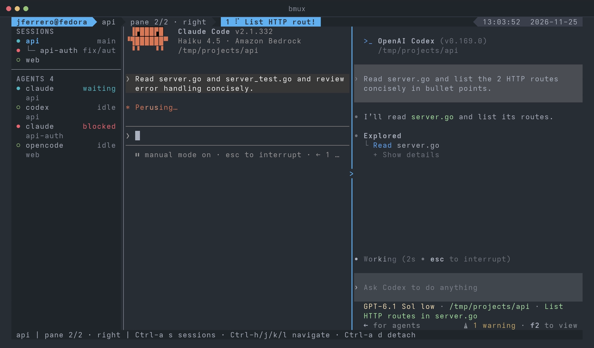
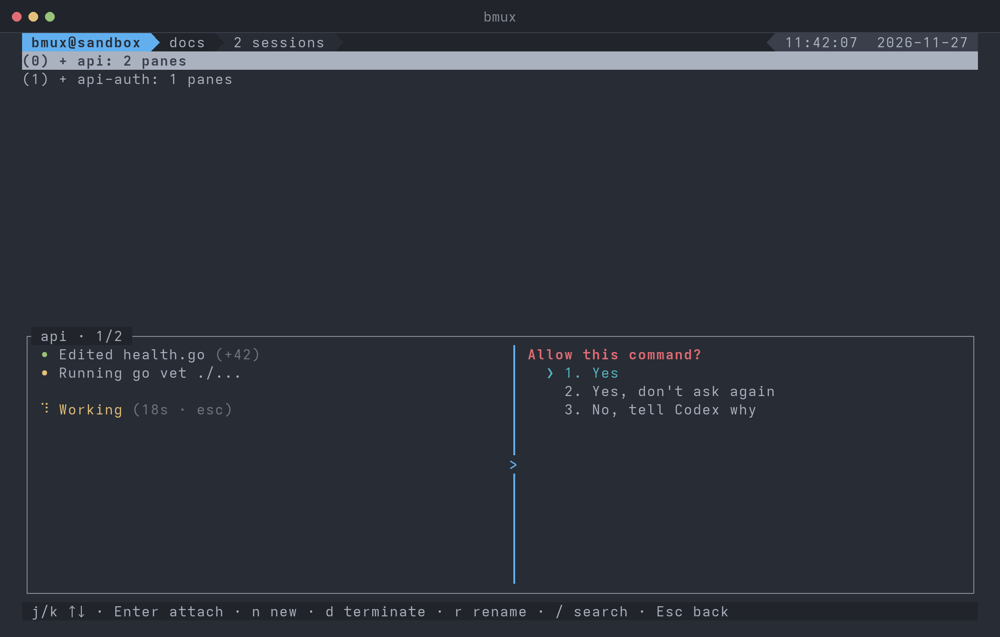

# bmux

**The batteries-included terminal multiplexer, built for coding agents.**

[](https://github.com/bmux-dev/bmux/actions/workflows/ci.yml)
[](https://github.com/bmux-dev/bmux/releases)
[](LICENSE)


bmux brings persistent sessions, a live-preview session picker, git worktree
grouping, a coding-agent status sidebar, and modeless mouse selection over SSH
into one static Go binary — local-first, zero telemetry, daily-driven on macOS
and Linux.

[Documentation](https://bmux-dev.github.io/bmux/guides/sessions/) · [Live Demo](https://bmux-dev.github.io/bmux/#demo) · [Coming from tmux](https://bmux-dev.github.io/bmux/start/coming-from-tmux/) · [Roadmap](ROADMAP.md)

<p align="center">
  <a href="https://bmux-dev.github.io/bmux/#demo">
    
  </a>
  <br />
  <sub>Project &amp; git worktree picker (<code>Ctrl-a n</code>) · Live coding-agent sidebar (<code>Ctrl-h</code>) · Session previews (<code>Ctrl-a s</code>) · <a href="https://bmux-dev.github.io/bmux/#demo">Full 30fps demo →</a></sub>
</p>

## Install & quick start

Requires macOS or Linux and an interactive terminal.

**Homebrew (macOS & Linux):**

```sh
brew install --cask bmux-dev/tap/bmux
```

**Install script** (SHA-256 verified against `checksums.txt`, installs to `~/.local/bin`, no `sudo` — see [`install.sh`](install.sh) and [installation options](https://bmux-dev.github.io/bmux/start/installation/)):

```sh
curl -fsSL https://raw.githubusercontent.com/bmux-dev/bmux/main/install.sh | sh
```

**From source** (Go 1.27.3+ — Go is only needed when building from source; Homebrew and `install.sh` ship self-contained static binaries):

```sh
go install github.com/bmux-dev/bmux/cmd/bmux@latest
```

> **macOS note:** Release binaries are not Apple-notarized yet. The Homebrew cask clears `com.apple.quarantine` automatically and `curl` never sets it; manual browser downloads from [GitHub Releases](https://github.com/bmux-dev/bmux/releases) need `xattr -d com.apple.quarantine bmux`.

### Your first two minutes

1. **Start a session** in any project folder:
   ```sh
   bmux
   ```
   The server starts automatically and names the session after the current directory. On first run, a welcome screen walks through the basic keys and optional [agent integrations](#agents).
2. **Split and copy without modes:** press `Ctrl-a |` (side by side) or `Ctrl-a -` (stacked), move focus with `Ctrl-h/j/k/l` or a click, drag with the mouse to select and copy on release, and scroll history with the wheel.
3. **Switch projects and watch agents:** press `Ctrl-a n` for the project & worktree picker, `Ctrl-a s` for the live-preview session picker (`/` filters), or launch a coding agent in any pane to track it in the left sidebar (`Ctrl-h` from the leftmost pane enters the sidebar).
4. **Customize and detach:** press `Ctrl-a ,` for live-preview settings, `Ctrl-a ?` for all bindings, and `Ctrl-a d` to detach. Return with `bmux attach` (running bare `bmux` again always creates a new session; use `bmux list`, `bmux attach NAME`, and `bmux kill NAME` from the shell).

**Coming from tmux?** The default prefix is `Ctrl-a`; set `prefix = "C-b"` in [configuration](#configuration) for tmux's, and every key can be [rebound](https://bmux-dev.github.io/bmux/configuration/rebinding-keys/).

## Agents

Run **Claude Code, Codex, Antigravity (`agy`), Gemini CLI, OpenCode, omp, pi**, or any custom CLI in any pane. bmux detects it from the pane's foreground process with zero setup and lists your sessions (grouped by git worktree with optional `ui.show-branch` labels) alongside every running agent in the sidebar:

| Indicator | State |
| --- | --- |
| red `●` | **blocked**: agent [reported](https://bmux-dev.github.io/bmux/agents/reporting-state/) it needs a decision |
| teal `●` | **waiting**: went quiet while unviewed (finished or asking for input) |
| teal `●` | **bell**: program sent a bell or desktop notification (OSC 9/777) |
| yellow `●` | **working**: actively drawing output |
| green `○` | **idle**: ready, and already seen |

A sound plays when an unviewed agent becomes ready or when any agent becomes blocked (`BMUX_SOUND=0` mutes it). Press `Ctrl-h` from the leftmost pane to move into the sidebar (`j/k` selects, `Enter` or `l` jumps to that pane across any session), and `Ctrl-a b` to toggle it (auto-hides below 80 columns).

bmux never scrapes agent state from screen text. For exact `working`/`blocked`/`idle` reporting and exact-session resume, install an agent's integration via `Ctrl-a i` or the CLI:

```sh
bmux integration status          # what's installed and on PATH
bmux integration install         # every agent found, or name one: install claude
bmux integration uninstall codex
```

Integrations exist for **Antigravity (`agy`), Claude Code, Codex, omp, opencode, and pi** (and also install the `bmux` skill for `agy`, `claude`, `omp`, and `pi`). Any custom agent can report state with `bmux agent working|blocked|idle|clear`. See [agent sidebar](https://bmux-dev.github.io/bmux/agents/sidebar/), [agent integrations](https://bmux-dev.github.io/bmux/agents/integrations/), and [reporting agent state](https://bmux-dev.github.io/bmux/agents/reporting-state/).

Agents can drive bmux directly (`bmux guide` teaches them the workflow):

```sh
bmux agents --json                                    # list agent panes + sequence numbers
bmux capture api:2                                    # read a pane's visible screen
bmux send api:2 --if-seq 12 --text "y" --key enter    # guard against races before sending
bmux wait-agent --since 12                            # block until another agent needs attention
```

See [scripting panes and agents](https://bmux-dev.github.io/bmux/agents/scripting/).

## Why bmux

| Instead of | Built into bmux |
| --- | --- |
| tmux-sessionx / tmux-fzf | List-first session picker with fuzzy filter (`/`) and live terminal preview |
| sesh / tmuxinator / tmuxp | Git-worktree project picker (`Ctrl-a n`) + trusted `.bmux.toml` layout files (`bmux layout save`) |
| tmux-resurrect + continuum | Auto-saves every 5s and on shutdown; restores layouts, directories, and agent conversations; `bmux restart` for upgrades |
| tmux-yank / copy-mode | Drag/double/triple-click copy (`pbcopy`, `wl-copy`, `xclip`, `xsel`, OSC 52) + optional vi scrollback view (`Ctrl-a v`) |
| vim-tmux-navigator | Foreground-aware `Ctrl-h/j/k/l` across panes and sidebar; `FocusGained`/`FocusLost` out of the box |
| tmux `allow-passthrough` | Native Kitty graphics retained per pane across scrollback, splits, windows, and detach |
| Separate agent dashboards | Built-in agent status sidebar, sound/notification alerts, hooks, and agent-control CLI |

<details>
<summary>Full 15-plugin tmux comparison &amp; live-preview screenshot</summary>

| Instead of | Built into bmux |
| --- | --- |
| tmux-sessionist | Create (`Ctrl-a n`), rename, and kill from the picker; `Ctrl-a p` last session; `Ctrl-a (` / `)` prev/next |
| tmux-pain-control | Splits (`Ctrl-a \|` / `-`) in focused dir, `Ctrl-a x` close with confirmation, `Ctrl-a h/j/k/l` repeatable resize, `Ctrl-a m` zoom |
| tmux-better-mouse-mode | Click to focus, drag dividers to resize, wheel scrolls history, `Alt`/`Shift` overrides mouse-aware apps |
| tmux-copycat | Scrollback search (`Ctrl-a /`), `n`/`N` matches, `[`/`]` prompt jumps (OSC 133) |
| tmux-notify | Sound on ready/blocked agents; bells and OSC 9/777 mark sidebar panes |
| tmux-prefix-highlight | Status line shows pending prefix and active resize repeat mode |
| tmux-powerline / themes | Powerline status bars, accent colors, and Neovim colorscheme presets (`bmux theme`) |

See [Coming from tmux](https://bmux-dev.github.io/bmux/start/coming-from-tmux/) for the complete side-by-side breakdown.

<p align="center">
  <a href="https://bmux-dev.github.io/bmux/guides/sessions/">
    <picture>
      <source media="(prefers-color-scheme: dark)" srcset="site/src/assets/screenshots/session-picker-dark.png" />
      <source media="(prefers-color-scheme: light)" srcset="site/src/assets/screenshots/session-picker-light.png" />
      
    </picture>
  </a>
</p>

</details>

### How bmux compares

- **vs. tmux + TPM:** Same client-server Unix socket architecture (server owns terminal state, attached clients own clipboard) and optional `prefix = "C-b"`, without maintaining a plugin manager or fragile clipboard/focus-event config.
- **vs. Zellij:** Familiar prefix ergonomics instead of modal locks that intercept shell keys, lighter chrome, list-first session/worktree switching, and native coding-agent orchestration.
- **Trade-offs:** No runtime plugin system by design (use `[hooks]` and the CLI instead), macOS & Linux only (no native Windows yet), and 0.x means config/CLI details may still evolve before 1.0.

## Performance

| Metric | bmux | Notes |
| --- | --- | --- |
| Keystroke latency | `1.5 ms` median (`2 ms` p99) | End-to-end client → server → PTY → client |
| Heavy build output | `200k` lines in `0.06 s` | On par with tmux |
| Memory footprint | `~21 MiB` RSS | Measured across 4 active sessions |
| Idle CPU usage | `0 Hz` redraws | Event-driven row delta pushes |

Measured against tmux 3.8 on Linux x86_64; reproduce locally with [`scripts/compare-tmux.py`](scripts/compare-tmux.py).

## Keys

`Ctrl-a s` means press `Ctrl-a`, release, then press `s`.

| Action | Keys or mouse |
| --- | --- |
| Session picker | `Ctrl-a s`, or click bottom status line (`/` filters, `j/k` moves, `Enter` attaches) |
| Project / worktree picker | `Ctrl-a n`, or `bmux project` (`bmux project DIR` attaches/creates directly) |
| Split side by side / stacked | `Ctrl-a \|` / `Ctrl-a -` |
| Focus pane / enter sidebar | `Ctrl-h/j/k/l`, `Ctrl-a` arrows, click (`Ctrl-h` from leftmost pane enters sidebar) |
| Zoom / close pane | `Ctrl-a m` / `Ctrl-a x` (asks first if a program is running) |
| Select & copy | Drag and release (`Alt` or `Shift` overrides mouse-aware apps); or `Ctrl-a v` |
| Search history | `Ctrl-a /`, then `n`/`N` |
| Settings | `Ctrl-a ,` |
| Detach / list all keys | `Ctrl-a d` / `Ctrl-a ?` |

<details>
<summary>All default keybindings</summary>

| Action | Keys or mouse |
| --- | --- |
| Last / next / prev session | `Ctrl-a p` / `Ctrl-a )` / `Ctrl-a (` |
| New window / select 1–9 | `Ctrl-a c` / `Ctrl-a 1…9`, or click tab on top bar |
| Next / prev / last window | `Ctrl-a ]` / `Ctrl-a [` / `Ctrl-a Tab` |
| Rename / close window | `Ctrl-a R` / `Ctrl-a &` (asks first if running) |
| Last pane / swap / rotate | `Ctrl-a ;` / `Ctrl-a {` `}` / `Ctrl-a Ctrl-o` |
| Pane to new / last window | `Ctrl-a !` / `Ctrl-a @` |
| Preset layouts / equalize | `Ctrl-a Space` (`Ctrl-a Alt-1…5`) / `Ctrl-a E` |
| Resize divider | `Ctrl-a h/j/k/l`, repeat `h/j/k/l` within 1s, or drag divider |
| Toggle / drive sidebar | `Ctrl-a b`; inside sidebar: click row, or `j/k`, `Enter`/`l`, `n` new, `d` delete, `Esc` |
| Copy / keyboard scrollback | `Ctrl-a y` copies selection; `Ctrl-a v` then vi moves, `v`/`V`/`Ctrl-v`, `y` |
| Scroll history | Mouse wheel or `Shift-PageUp`/`PageDown` |
| Paste / reload config | Terminal paste shortcut / `Ctrl-a r` |
| Send `Ctrl-a` to pane | `Ctrl-a Ctrl-a` |

</details>

See the [keybindings guide](https://bmux-dev.github.io/bmux/guides/keys/), [stopping the server](https://bmux-dev.github.io/bmux/reference/runtime-files/#stop-the-server), and [uninstalling](https://bmux-dev.github.io/bmux/reference/runtime-files/#uninstall).

## Vim and Neovim navigation

`Ctrl-h/j/k/l` move between panes and into the sidebar when the pane is not running Vim or Neovim; inside those editors, the keys pass through to move between editor splits. Add [`nvim-bmux-navigator` or a small mapping](https://bmux-dev.github.io/bmux/guides/editor-navigation/) to cross seamlessly from an editor edge split into adjacent bmux panes.

Outside an editor, bmux intercepts these keys, so `Ctrl-l` does not clear the shell by default. Add `"C-l" = "none"` under `[keys.root]` to give it back, or add programs like `fzf` to `keys.pass-through` (`Ctrl-a` arrows, `Ctrl-a o`, and clicks always switch panes directly). Terminal focus events (`FocusGained`, `FocusLost`, `autoread`) work automatically without extra configuration.

## Restarts and upgrades

bmux saves snapshots every 5 seconds and on clean shutdown. After an upgrade, crash, or reboot, the next server restores:

- every session, its windows and window names, split layout, zoom state, and focused pane;
- a fresh shell in each pane's last directory;
- built-in resume for `agy --continue`, `claude --continue`, `codex resume --last`, `opencode --continue`, `omp --continue`, and `pi --continue` (plus any custom agent configured under `[restore.resume]` or reporting a resume command via its integration).

Restored panes are fresh processes rather than live-migrated PTYs: scrollback and arbitrary running programs do not come back after a reboot.

When a new release is out, `↑` appears on the right end of the status line:

- **Homebrew:** `brew upgrade --cask bmux && bmux restart`
- **Install script / release binary:** `bmux update && bmux restart`

`bmux update` replaces only the binary (until `bmux restart`, the hint shows `↻`), then `bmux restart` restarts the server and reconnects attached clients automatically. Release and `go install ...@latest` builds check `api.github.com/repos/bmux-dev/bmux/releases` once daily with zero telemetry (local `go build` checkouts skip this); set `update.check = false` or `BMUX_NO_UPDATE_CHECK=1` to disable it. See [Restarts and reboots](https://bmux-dev.github.io/bmux/guides/restarts/).

## Configuration

Everything works with no config file. Press `Ctrl-a ,` for the live-preview settings UI, or edit `~/.config/bmux/config.toml` (`bmux default-config` prints every option with defaults):

```toml
theme = "catppuccin-mocha"  # or tokyonight, gruvbox-light, nord, onedark, dracula, ...
prefix = "C-b"

[ui]
accent = "amber"

[sidebar]
width = 30

[agents]
extra = ["myagent"]
waiting-after = "5s"

[restore.resume]
claude = ["claude", "--continue", "--model", "opus"]

[keys.root]
"C-l" = "none"              # restore Ctrl-l clear-screen in shells

[keys.prefix]
"v" = "split-right"
"minus" = "split-down"
```

Reload changes with `Ctrl-a r`, `bmux reload`, or `SIGUSR1` to the server. Mistakes appear in a floating notice box and that setting keeps its default.

bmux ships 25 theme presets (`dark`, `light`, Catppuccin, Tokyo Night, Gruvbox, Nord, Rosé Pine, Kanagawa, One Dark, Dracula, Everforest, Solarized) with `bmux theme NAME` for scripts or Neovim `ColorScheme` autocmds, plus `[hooks]` for lifecycle events and `BMUX_*` environment variables (`BMUX_THEME`, `BMUX_ACCENT`, `BMUX_POWERLINE_ASCII`, `BMUX_TERMINAL_PADDING`, `BMUX_SOUND`, `BMUX_NO_UPDATE_CHECK` override config settings; `BMUX_CONFIG`, `BMUX_RUNTIME_DIR`, and `BMUX_PPROF_DIR` configure paths and profiling). See [configuration](https://bmux-dev.github.io/bmux/configuration/config-file/), [switching themes](https://bmux-dev.github.io/bmux/configuration/config-file/#switching-themes-from-a-script-or-neovim), and [environment variables](https://bmux-dev.github.io/bmux/configuration/environment/).

## Contributing

Issues and pull requests are welcome (include OS, terminal emulator, `bmux version`, and reproduction steps for bugs). Check [ROADMAP.md](ROADMAP.md) for what's next, and read [AGENTS.md](AGENTS.md) and the [architecture guide](https://bmux-dev.github.io/bmux/project/architecture/) before changing terminal or session behavior.

```sh
go build -o bin/bmux ./cmd/bmux
go test ./...
go test -race ./...
go vet ./...
```

See [Releasing](https://bmux-dev.github.io/bmux/project/contributing/#releasing) for release steps.

## License

[MIT](LICENSE)
